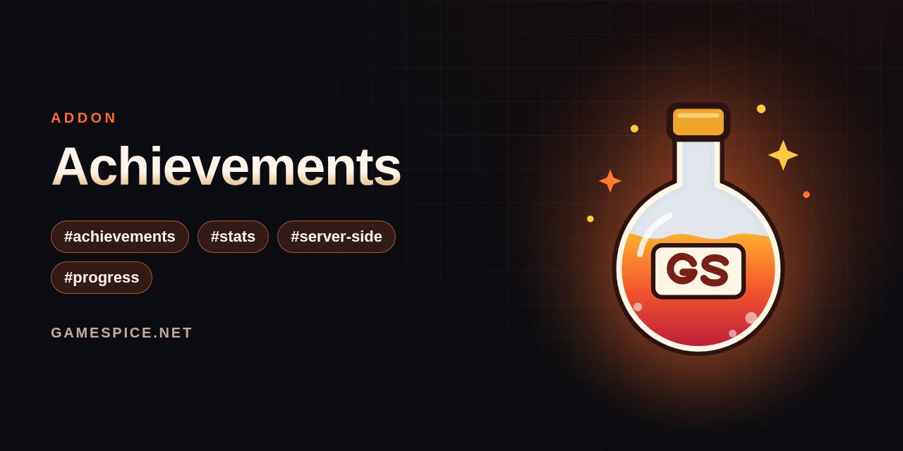

[](https://moddingcommunity.com/a/233-dot-achievements)

Achievements for Godot 4.7+, kept as data. You declare rules over per-player numbers once, and a dedicated server can check what a player has earned without loading any picture, icon or scene. Part of the [dot-*](https://github.com/gamespice-platform) family.

It supports counters, bests, tiers, hidden and secret entries, progress that is never misreported, a pluggable store (memory, a file per player, or SQL), a batched reporter for the TMC back end, and a signed points event reporter for [**GameSpice**](https://gamespice.net) app points.

Why data? An achievement whose condition lives inside the code that awards it cannot be listed, shown as progress, or checked against a save file. As data, a server can validate the whole catalogue at boot.

## Install

1. Copy `addons/dot_achievements/` and `addons/dot_core/` (from [dot-core](https://github.com/gamespice-platform/core)) into your project.
2. Enable dot-achievements in *Project > Project Settings > Plugins*.

Optional, and never named in the source:

| Addon | What it adds |
| --- | --- |
| [dot-stats](https://github.com/gamespice-platform/stats) | The natural source of the numbers, bridged by `DotAchievementStatsLink`. |
| [dot-auth](https://github.com/gamespice-platform/auth) | The back-end client for reporting. |
| [dot-sql](https://github.com/gamespice-platform/sql) | SQLite, Postgres or MySQL/MariaDB storage. |
| [dot-cloud](https://github.com/gamespice-platform/cloud) | The RSA signature `DotPointsReporter` signs its batches with. |

## Quick start

```gdscript
var catalogue := DotAchievementCatalogue.of([
    DotAchievement.counter(&"k10",  "First Blood", &"kills", 10),
    DotAchievement.counter(&"k100", "Centurion",   &"kills", 100),
    DotAchievement.make(&"flawless", "Flawless", [
        DotAchievementRule.make(&"round_wins", 1),
        DotAchievementRule.make(&"deaths", 0, DotAchievementRule.Op.AT_MOST),
    ]),
])

var tracker := DotAchievementTracker.new()
tracker.catalogue = catalogue
tracker.store = DotAchievementStoreFile.new("user://achievements")
tracker.unlocked.connect(func(player: String, a: DotAchievement) -> void:
    hud.toast("%s unlocked" % a.display_name))
add_child(tracker)

await tracker.begin(player_key)         # loads their lifetime numbers
tracker.record(player_key, &"kills", 1)
await tracker.end(player_key)           # saves
```

`record()` merges by the kind the rule declared: a counter adds, a best keeps the better value.

## Stores

| Store | Use it for |
| --- | --- |
| `DotAchievementStoreMemory` | Tests and throwaway sessions. |
| `DotAchievementStoreFile` | One file per player on disk. |
| `DotAchievementStoreSql` | Servers that share progress. Needs a dot-sql driver. |

```gdscript
var store := DotAchievementStoreSql.new(driver)   # any dot-sql driver
await store.open()                                # creates or migrates its two tables
tracker.store = store
```

The SQL store keeps one row per held number and one row per unlock (`dot_achievement_values` and `dot_achievement_unlocks`; both table names are configurable). That makes "how many players earned this" a query. Saves are batched and serialised per player.

## With Stats

```gdscript
var link := DotAchievementStatsLink.new()
link.tracker = tracker
link.stats = stats_tracker
add_child(link)
```

dot-stats reports a session total, but an achievement is about a lifetime. The link remembers a baseline and files only the difference, and treats a total that goes down as a new session.

## Showing achievements

```gdscript
for row in tracker.listing(player_key):
    print(row["name"], row.get("progress", row.get("unlocked")))
```

Hidden entries are left out until earned. Secret ones are listed without their description. The filtering happens in the tracker, so a withheld description is never sent to the client.

## Points events

A dedicated server reports what happened (a kill, a round won) and the site decides what it is worth. Nothing here sends an amount.

```gdscript
var cfg := DotPointsReporterConfig.new()
cfg.app_id = 12
cfg.server_id = 34
cfg.private_key_path = "/etc/mygame/points.pem"
var loaded := cfg.load_layered("")   # DOT_POINTS_* and --points-* override
var points := DotPointsReporter.new()
add_child(points)
var configured := points.configure(cfg)   # fails loudly on a bad config or key
points.report(player_key, "kill", 1, {"humans": 10, "vsBot": false})
```

`report()` returns the eventId. `events_settled(results)` carries the site's answer for each event, and `batch_dropped(event_ids, error)` names events the site refused as a whole batch.

| Key | Meaning |
| --- | --- |
| `app_id`, `server_id` | Required. The app and this server on the site. |
| `private_key_path` / `private_key_pem` | The server's RSA private key (2048 bits or more). Set one of the two. |
| `flush_interval_secs` | Seconds between flushes. 0 = no timer; call `flush()` yourself. |
| `max_batch_events` | Events per signed request. 0 = unlimited. |
| `max_pending_events` | Events held while the site is unreachable. 0 = unlimited; past it `report()` fails. |

The app owner registers the server's public key once: `POST /api/app/v1/apps/:id/points/keys` with `{serverId, alg: "RSA_SHA256", publicKey}` (SPKI PEM). See [docs/design.md](docs/design.md#the-points-reporter).

## Site catalogue file

You can export a catalogue as the site's `dot-achievement-defs` JSON, so the site owner can import it from the dashboard. Run `tools/export_site_defs.gd` from your game project:

| Option | Meaning |
| --- | --- |
| `--source` | Script that holds the static method returning your `DotAchievementCatalogue`. |
| `--method` | Name of that method. |
| `--out` | Output file. Default `deployment/achievement-defs.json`. |
| `--game` | Pin the site app id. Left out by default so one file imports into any environment. |
| `--check` | Write nothing and exit 1 if the file is stale. |

`op` in a rule is one of `at_least`, `at_most`, `equals`, `not_equals`. `merge` is one of `sum`, `latest`, `highest`, `lowest`. Importing merges by `key`: achievements the file does not mention, and all unlocks, are kept.

## Test

```bash
godot --headless --path . --import
godot --headless --path . res://examples/achievements_selftest.tscn
godot --headless --path . res://examples/points_selftest.tscn   # needs dot-cloud linked into addons/
```

These run offline and exits non-zero on any failure. To test the SQL store against real SQLite, Postgres and MariaDB, link dot-sql into `addons/` and run:

```bash
../dot-sql/tools/test_live.sh . res://examples/achievements_sql_live.tscn
```

## Status

Built and maintained with Claude Code. The test suites pass, but little of this has been in front of real players yet. Please report rough edges by opening an issue.

## Licence

MIT. See [LICENSE](LICENSE). Only the TMC back-end web infrastructure is not open source; if you use your own back end, you build that part yourself.
